<div align="center">

# ⛧ Grimmoire

**A terminal-native, ASCII-first dark-fantasy wizard RPG.**

Every wall, every candle, every face is a character drawn into a cell grid by a
renderer Grimmoire owns. No image files, no sprites, no graphics protocol — just
glyphs, ink, and light.

The cast is a **library of fixed sprites**: seven cells wide, five tall, drawn in
eight inks each — outline, mass, shade, light, highlight, metal, eye and accent.
The art is stored row for row and never trimmed or recoloured; what colour a cell
is depends on what the cell *is*, and a test compares the library against the
supplied art so a stray edit fails the build.

Talk to people. Ask things. Some of them lie, and remembering that changes what
they say next.

[](https://github.com/etokiyra/grimmoire/actions/workflows/ci.yml)
[](LICENSE)
[](https://www.rust-lang.org/)
[](https://sw.kovidgoyal.net/kitty/)
[](#requirements)
[](#why-it-looks-the-way-it-does)

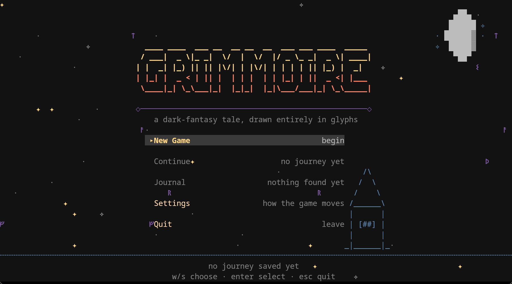

</div>

> **Status: early development.** There is no release and no tagged version yet.
> Grimmoire is a small, playable **anime-inspired exploration RPG** — a five-scene
> prologue, a title screen, a region of six connected places, nine characters to
> talk to, twelve journal entries, one puzzle, conversations with real choices
> that change the world, and fail-soft saving — on top of a custom ASCII renderer.
> It is not a complete game.

## The region

```
                       Hollow Village
                             │  │
   Ruined Chapel ── Whispering Woods ── Moonwell Shrine
        │                                     │  (sealed until answered)
   Sunken Cellar ── Forgotten Catacombs ───────┘
```

Six places, all reachable without solving anything; the moonwell opens a
*shortcut* between the shrine and the catacombs rather than a door you have to
earn. Each one has its own floor, its own air, and its own reason to be walked
through twice.

<div align="center">

| | |
| --- | --- |
| **Ruined Chapel** — where you wake. Ysolde has no face and remembers the village. | **Sunken Cellar** — four flooded chambers and a bridge you would rather not slip off. |
| **Whispering Woods** — a trail between two places, a keeper with a lantern, and a glade nobody mentions. | **Hollow Village** — a crossroad, six fallen houses, a dry well, and Cassen, who is lying. |
| **Moonwell Shrine** — a pale hall around a well. Three braziers, a dial, and a priestess who answers obliquely. | **Forgotten Catacombs** — burial galleries, a scribe's tomb, and Vesper, who would rather you left. |

</div>

## What it is

A game about a wizard who grows stronger through **knowledge rather than gear**,
built for the terminal and taking **ASCII art as its primary visual language**
rather than as a limitation to escape.

The loop is **explore → discover → learn → unlock → explore further**. Examining
something worth examining writes an entry in the **journal** (<kbd>J</kbd>): the
setting, told a piece at a time. Discoveries change what characters say, and one
of them opens a door that was not going to open.

Talking is the other half of it. Conversations branch: you can ask, refuse,
press someone on a lie, or say nothing at all, and what you choose is
remembered. Accusing the village scavenger of cutting the well-rope changes how
he greets you afterwards, and is what makes the mage who has been "passing
through" for nine years admit she cut it herself.

There is no experience, no loot, and no combat yet — and deliberately so: the
reward for looking closely is knowing more. The long-term vision is
character-focused dialogue, strategic turn-based magic combat, skill trees, and
story-and-mastery progression.

This phase has a story, and [`docs/story.md`](docs/story.md) is its bible: a
village that survived a drought by agreeing, together, to feed the water, and a
shrine that has spent four hundred years making sure nobody finishes the sentence
that would end it. The wizard arrives nine years after the water stopped coming
back. What the wizard is, what lies past the sealed door, and what the moon's name
is are **deliberately left open** — the name is never written down. See
[`ROADMAP.md`](ROADMAP.md).

## Why it looks the way it does

- **ASCII is the identity, not a fallback.** The world is a grid of glyphs drawn
  by a renderer Grimmoire owns (`ui::scenery`). Block and box glyphs (`█`, `▓`,
  `▀`, `·`) are legitimate drawing elements. There is no hidden image underneath.
- **Structure comes from neighbours.** A wall shows a lit cap where floor is
  above it, a shadowed base where floor is below, a side face, or a pillar when it
  stands alone. Terrain is not a repeating tile.
- **Variation comes from position, never from time.** Each tile's texture is a
  hash of its *world* coordinates, so the world never shimmers when the clock
  advances.
- **Light comes from distance.** Tiles near the player fall into a warm autumn
  wash; the far walls drop into the dark. The space reads as lit rather than flat.
- **Characters are figures with several inks at once.** A cast member carries its
  own ink set, and each row of its sprite names one — so hair, skin, cloth, trim
  and eyes are separate colours. Figures are **five cells wide and three tall**,
  the height of a doorway or a tree.
- **Maps are authored at the character's scale.** No passage the player can stand
  in is narrower than three cells, and the routes walked constantly are wider
  still. The generator refuses to emit a map that breaks the rule, and a test
  enforces it. See [`docs/map-design.md`](docs/map-design.md).
- **Every place has a material and an air.** The wood is floored in grass and
  breathes pollen and blossom; the shrine is pale marble under cold silver motes;
  the catacombs are bone dust. You should know where you are before you read the
  name.
- **Names and words live in the model.** `Entity::name`, `Dialogue::speaker` and
  every journal line are content; the renderer has no idea what any of them say.

The player is a small wizard in violet and royal blue, with a gold-tipped staff
and a gem at their collar. They have two walk poses, a breath and a sprint,
chosen once per *step* so a pose can never drift from the movement it illustrates,
and facing west is the same art reflected so the staff changes hands.

Nine characters are in the world: a hooded wraith with two cold lights, a lantern
keeper, a scavenger under a bundle, a priestess under a crescent crown, a
skeleton wound in grave-wrappings, an apprentice with ribbons, a wandering mage
under an enormous hat, a moss-and-mushroom spirit, and a warden in plumed steel.
Eight more — a necromancer, a plague doctor, an assassin, an imp, a bat, an ooze,
a drake, and the Lich King — are in the library for what comes next.

<div align="center">

</div>

## Screenshots

<div align="center">

**The prologue.** Five scenes, each with its own composition, sky and caption:
the village below the wood and one lamp going out; the shrine deciding; the walk
down to the water; and the chapel afterwards, with nothing lit in it. Then the
chapter card, which builds itself.

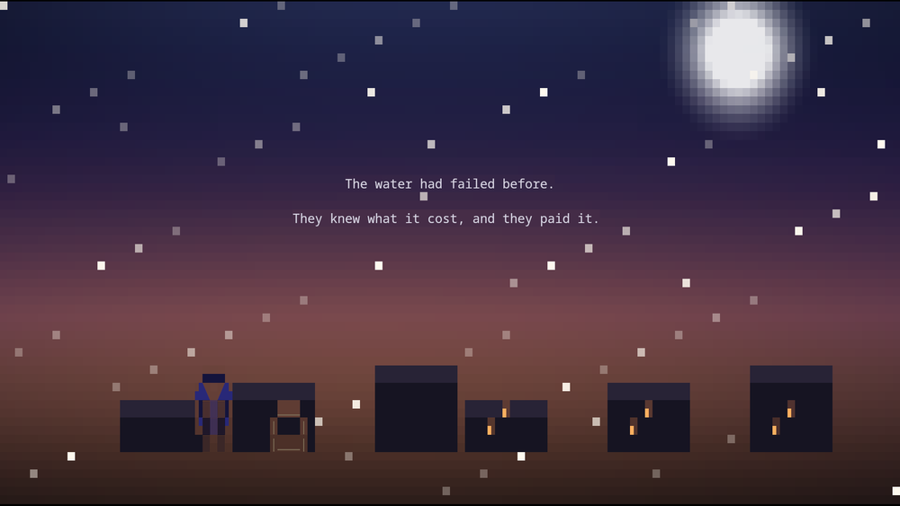
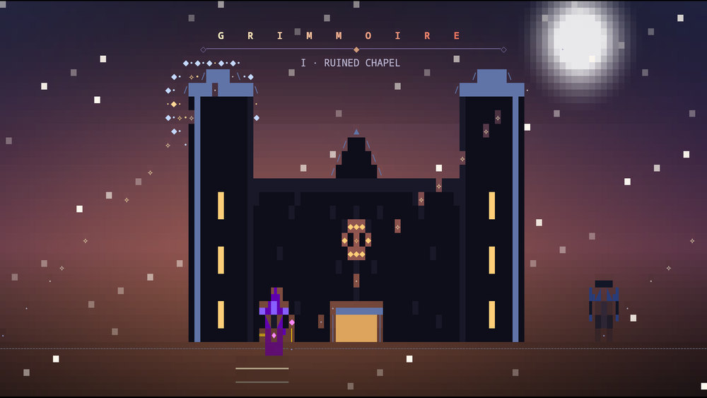

**The opening.** A night sky of twinkling glyphs, a moon, a horizon with the
chapel standing on it, and the name in a warm ramp. The menu knows whether there
is a journey to continue, and starting again over one asks first.


**Conversations.** A speaker's face in its own inset, their name set into the
plate, lines that arrive a character at a time — and, when they are asking
something, the things you can say back.


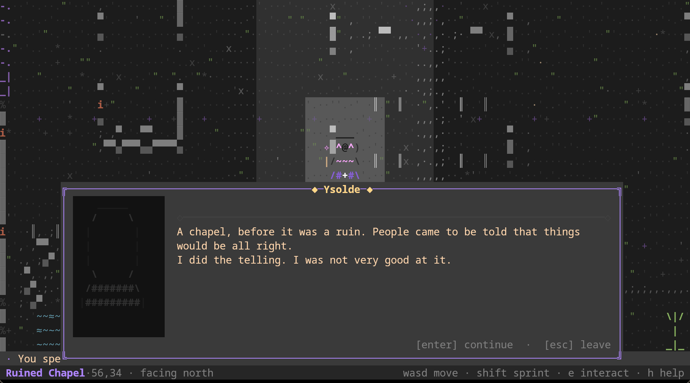

**Finding something.** A discovery announces itself over the world and is written
into the journal, which is the reward the game gives.

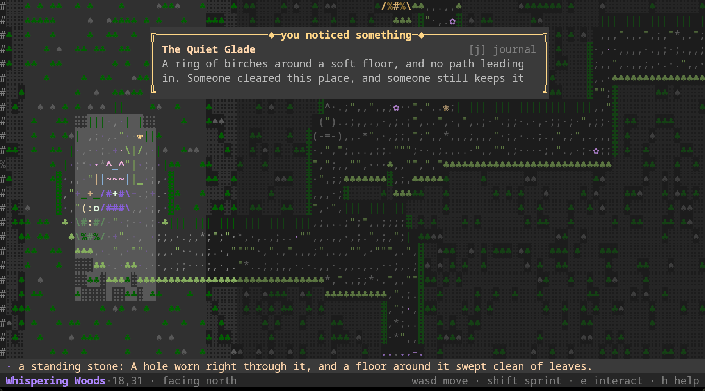
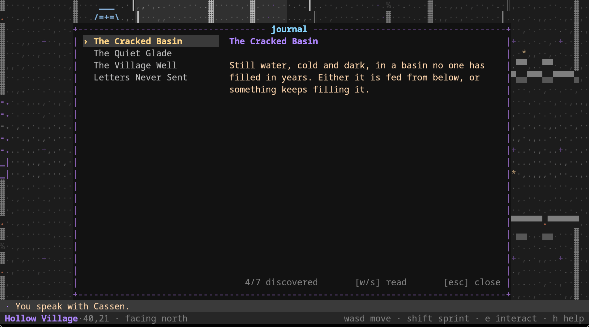

**The world.** A dark wood, a dead village, a shrine of pale stone, and a
catacomb of bone.

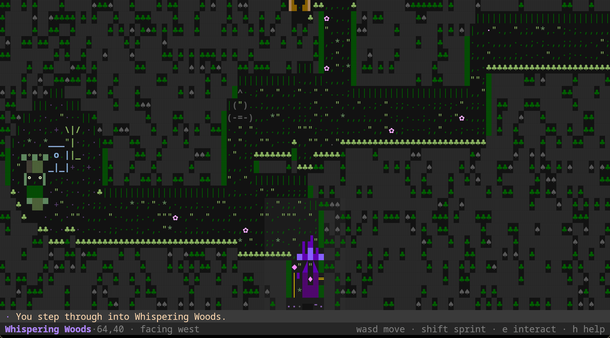
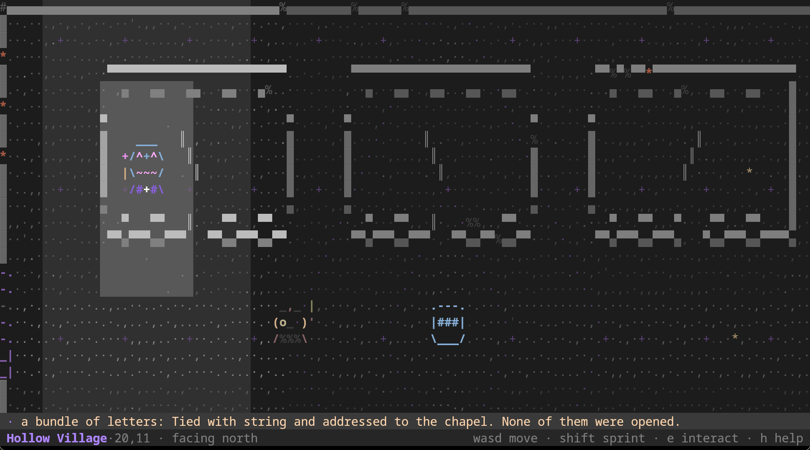
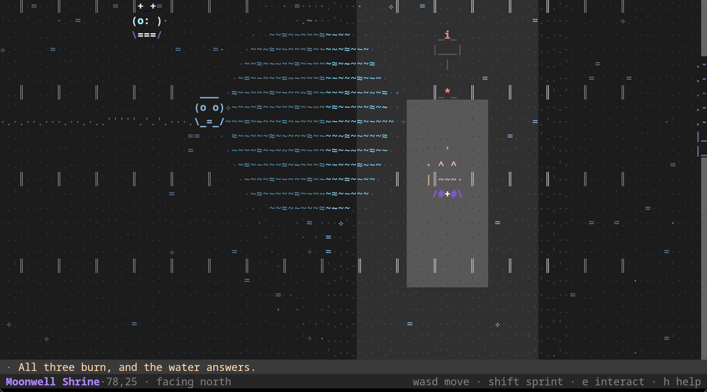
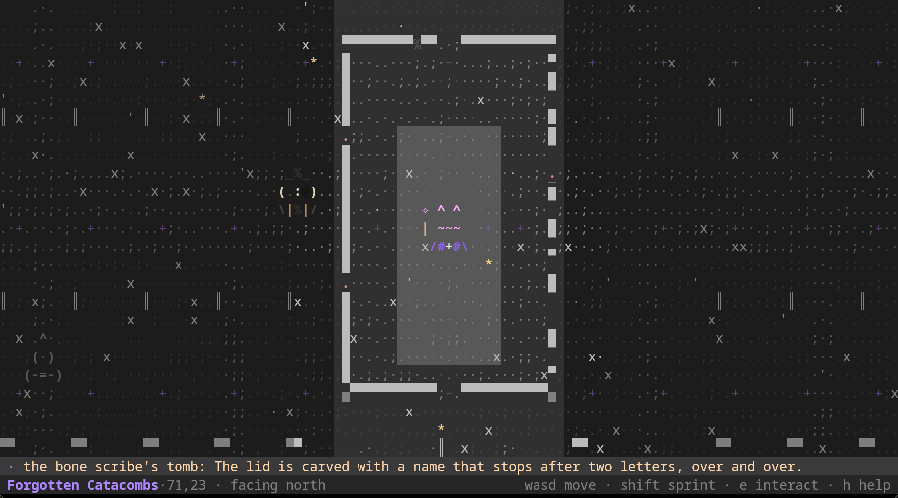

**The world answers.** Two choices change a place rather than a line: tell Ysolde
to go and see the wall and the chapel is lit for the first time since the water
left; tell Rin the twelfth lantern belongs to somebody too and it burns in the
wood.

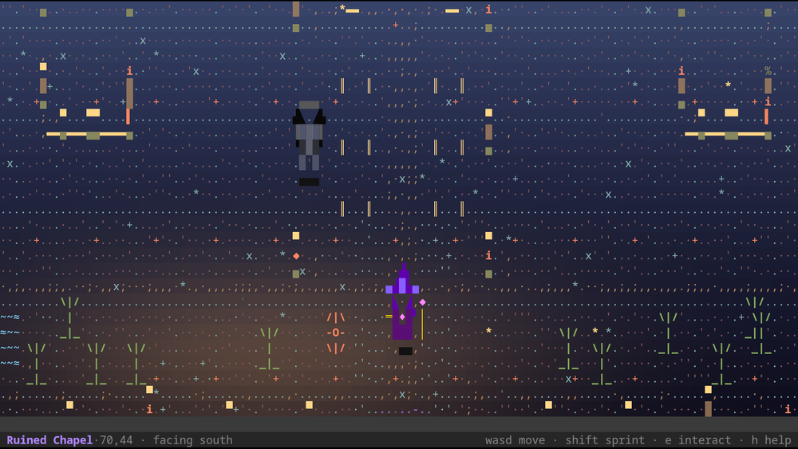
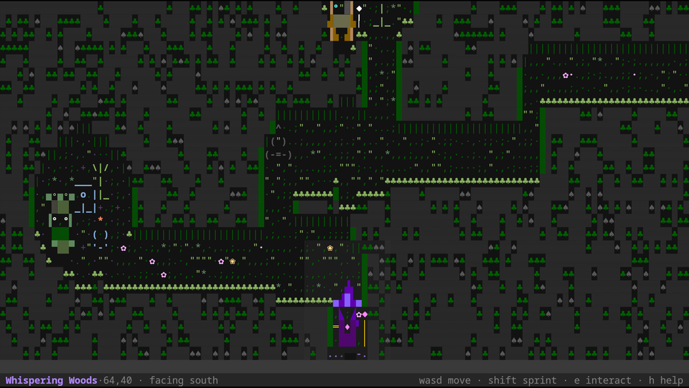

</div>

## Requirements

**Grimmoire runs in [Kitty](https://sw.kovidgoyal.net/kitty/).** It uses Kitty's
keyboard protocol so that it can see key *releases*, which is what makes "hold to
walk, release to stop" work properly. If it cannot establish that the terminal can
do this, it says so and exits rather than starting in a mode that would feel
broken.

Everything else it needs is a Rust toolchain (**1.85+**, edition 2024) and a
terminal of at least **80×24** reporting 256 colours.

## Play it

```sh
kitty --directory "$PWD" cargo run --release
```

A new game opens with the **five-scene prologue**. <kbd>Esc</kbd>, <kbd>Enter</kbd>
or <kbd>Space</kbd> skips it. Then you start in the **Ruined Chapel**: the stair
down to the Sunken Cellar is at the south end of the nave, and a door in the west
wall leads out into the Whispering Woods. Press <kbd>e</kbd> when the prompt
appears, and <kbd>J</kbd> to read what you have found so far.

| Key | Action |
| --- | --- |
| <kbd>W</kbd> <kbd>A</kbd> <kbd>S</kbd> <kbd>D</kbd> or arrows | Move, and face that way. **Hold to keep walking.** |
| <kbd>Shift</kbd> + a direction | Sprint |
| <kbd>E</kbd> | Interact with what you face |
| <kbd>J</kbd> | The journal of what you have found |
| <kbd>W</kbd>/<kbd>S</kbd>, <kbd>Enter</kbd> | Move between choices, and say one |
| <kbd>Esc</kbd>, <kbd>Enter</kbd>, <kbd>Space</kbd> | Skip the prologue |
| <kbd>Esc</kbd> | Leave a conversation (what was said still counts) |
| <kbd>H</kbd>, <kbd>?</kbd>, <kbd>F1</kbd> | Help and diagnostics |
| <kbd>F3</kbd> | Presentation study (rendering prototype) |
| <kbd>F2</kbd> | Renderer showcase (development screen) |
| <kbd>Q</kbd>, <kbd>Ctrl</kbd>+<kbd>C</kbd>, or <kbd>Esc</kbd> elsewhere | Quit |

Progress saves automatically on quit and whenever you move between areas — see
[`docs/gameplay.md`](docs/gameplay.md) for the save location and format.

Below **80×24** the game suspends, shows a short explanation, and swallows input
so you cannot act blind, then resumes exactly where you were when the window
grows. Grimmoire cannot maximise your window; that part is yours.

## What works today

**The exploration RPG**

- Six connected areas that are **bigger than the viewport**, so the camera scrolls
  and the environment fills the screen. Every one is reachable from the start.
- **A five-scene prologue** — a village and a lamp going out, a shrine deciding,
  a walk down to the water, the chapel afterwards, and a chapter card that builds
  itself. Every scene has its own composition, sky and caption, and the prologue
  can be skipped.
- **An animated title screen** with a menu that reflects the save, a safe
  confirmation before starting again, and settings of their own.
- **Nine characters**, each with their own silhouette, inks, portrait and voice:
  a veiled keeper of the chapel, a lantern child in the wood, a scavenger who is
  lying about something, a priestess who answers in the right order for the wrong
  reasons, something in the catacombs that resents being awake, a shrine
  apprentice with too much energy, a wandering mage under an enormous hat, a
  moss-and-mushroom spirit who speaks in halves, and a warden in steel with a
  notebook.
- **Conversations with choices.** Ask, refuse, press, or stay quiet; what you
  choose is remembered, changes what that character says next, and sometimes
  changes what someone else says too.
- **A journal** of what you have found — twelve entries for this phase — written
  when you find it rather than when you arrive somewhere, and kept across saves.
  Discoveries announce themselves over the world the moment they are made.
- **Discoveries that matter**: what you learn changes what a character will say to
  you, and answering the moonwell opens a way that was sealed — for both
  directions, so it is a shortcut and not a toll.
- **Choices that change a place**, not just a line: tell Ysolde to go and see the
  wall and the chapel is lit for the first time since the water left; tell Rin the
  twelfth lantern belongs to somebody too and it burns in the wood. Both stay
  changed in the save.
- **One puzzle** with its rules written on the floor: three braziers, a dial, and
  an order. Lighting them out of turn puts all three out, so the order has to be
  read rather than guessed, and it can never be soft-locked.
- Tile-based movement with collision against terrain, boundaries and entities,
  plus a facing direction so you can face what you want to use.
- **Event-driven movement**: a press steps at once, holding walks at a steady
  cadence, releasing stops immediately, and <kbd>Shift</kbd> sprints. A tap is
  always exactly one step, and no lost event can leave you walking on your own.
- **Visible feedback**: a refused step pulses the tile that refused it, an
  interaction flashes whatever answered and throws off sparkles, and arriving
  somewhere new marks the spot — all as a style change, so nothing can ever hide a
  glyph.
- **Animation that keeps pace**: characters stride once per *step* (never on a free
  running clock), sprint with a lean and a wake, breathe and blink when idle, and
  the dialogue panel rises and settles rather than appearing.
- **Both axes move at the same screen speed.** Terminal cells are taller than they
  are wide, so the two axes are paced from one speed in pixels per second rather
  than a single step rate — which is what stops vertical movement feeling twice as
  fast as horizontal.
- An interaction model resolved deterministically from the adjacent tiles, with a
  contextual prompt instead of permanent instructions.
- Automatic, versioned, **fail-soft** persistence of area, position, discovered
  areas, the journal, the shrine's progress, and the story facts conversations
  established. Anything unrecognised means "start a new game", never a
  half-loaded one; a save written by an older version is *migrated*, not
  discarded.
- **Preferences of their own** (full, reduced, or no motion), in a file of their
  own, so turning the animation off cannot be lost by starting a new game.

**The renderer underneath**

- A **custom ASCII scenery renderer** — neighbour-aware walls, position-hashed
  floors, rolling water, guttering candles, drifting motes, and an inlaid motif cut
  into each area's open floors.
- A pure, terminal-agnostic cell renderer: `Canvas`, `Cell`, `Style`, `Color`,
  `Rect`, and a clipped local-coordinate `CanvasView`.
- A **fully opaque, application-owned background**: the theme paints every cell and
  foreground-only draws inherit the surface, so the terminal's own theme can never
  show through.
- **Diffed presentation**: only changed cells are written. An unchanged frame costs
  sixteen bytes.
- **A 60 Hz loop while anything is moving** (measured at 60–64 frames a second),
  dropping to a slow ambient tick when the world is merely breathing, so an
  untouched game costs about **half a percent of a core**.
- Time-based animation with an explicitly advanced, testable clock.
- A screen stack with layered composition, a curtain transition, and a
  **minimum-viewport policy**.
- Optional **pixel interface art** behind a development flag, off by default; the
  game itself never emits a graphics sequence.

## Not implemented yet

Combat, spells, inventory, items you can pick up, quests, and skill trees. There
is no scripting language: a conversation is a data graph that branches on what you
know and on what you have done, and the graph is checked at build time. The
wizard's own history, the moon's name, and what lies past the sealed door are
deliberately unwritten — see [`docs/story.md`](docs/story.md).

## Build and run

```sh
cargo run                        # run a debug build
cargo run --release              # run an optimised build
cargo run --release -- --study   # the presentation study
cargo build --release            # produce target/release/grimmoire
```

Resize the terminal freely: the layout and camera are recomputed, and below 80×24
play suspends to a short explanation rather than drawing a mangled layout. The
terminal — including the Kitty keyboard protocol — is restored on a normal exit,
on a recoverable error, and from a panic.

### Development overrides

| Variable | Effect |
| --- | --- |
| `GRIMMOIRE_ASSUME_KITTY=1` | Assume the terminal is Kitty even if it cannot be confirmed. For inspecting the game in another terminal, and for the pty smoke test. |
| `GRIMMOIRE_PIXEL_UI=1` | Draw interface pieces (the dialogue portrait) as pixel art. Off by default; equivalent to `--pixel-ui`. |
| `GRIMMOIRE_FRAME_STATS=1` | Print the measured frame rate on exit. |

## Development

Run the same checks that CI runs:

```sh
cargo fmt --all --check
cargo clippy --all-targets --all-features -- -D warnings
cargo test --all-targets
cargo build --release
```

Three tools are kept honest by use:

```sh
tools/smoke.sh                     # pty smoke test: terminal lifecycle and cleanup
cargo run --release --example preview    # print the ASCII world to the terminal
cargo run --release --example bench      # the performance numbers in the design doc
```

`examples/preview` is the quickest way to look at scenery: it renders a real area
as text, so art changes can be read and diffed without a screenshot.

## Architecture

Grimmoire owns its drawing model, layout, frame composition, scenery and
animation. It borrows plumbing for low-level terminal operations and does **not**
build a terminal emulator.

| Module | Responsibility |
| --- | --- |
| `game` | The world model and its rules: areas, tiles, entities, movement, collision, interaction, travel, and progression. Pure — no rendering, no I/O. |
| `game::conversation` | Branching dialogue as data: nodes, choices, conditions, effects. |
| `game::discovery`, `game::progress` | What can be learned, what has been, and the shrine puzzle's state. |
| `save` | A small versioned format, its migration path, and the only code that touches the save file. |
| `render` | Pure, terminal-agnostic drawing: cells, styles, colours, rectangles, canvases, views, `Frame` composition, image handles, and the optional PNG encoder. |
| `terminal` | The **only** module that talks to the terminal: raw mode, alternate screen, the Kitty keyboard and graphics protocols, input, capability detection, and diffed presentation. |
| `anim` | Time-based animation with an explicitly advanced clock. |
| `input` | Terminal-independent key and event types, including press/repeat/release. |
| `ui` | Frame composition: the ASCII scenery renderer, the cast table, character animation, feedback effects, the title screen, conversations, the journal, the ornament vocabulary, theme, layout, motion, screens, transitions, the screen stack, and the viewport policy. |
| `ui::sprite` | The character sprite library: art, inks and poses. |
| `ui::settings` | The player's preferences, in their own file, shared with the screens that change them. |
| `app` | Wires input, update, compose and present together. |
| `pixel` | Software pixel rendering, used only by optional interface art. |

The dependency list is deliberately short: **`crossterm`** for terminal lifecycle
and input, **`unicode-width`** for the text width policy, and **`fdeflate`** solely
to encode the optional pixel interface art. `ratatui` was rejected because it would
own the drawing model. No image decoder is needed — Kitty decodes.

### Documentation

- [`docs/renderer-design.md`](docs/renderer-design.md) — the rendering
  architecture, the ASCII scenery renderer, the movement model and why the two axes
  are paced differently, the measured numbers, and what was verified live.
- [`docs/renderer-investigation.md`](docs/renderer-investigation.md) — the
  renderer's structural limits, the atmosphere layer's investigation, and what each
  stage of it established.
- [`docs/gameplay.md`](docs/gameplay.md) — the world model, controls, movement,
  interaction rules, and save format.
- [`docs/story.md`](docs/story.md) — the narrative bible: what actually happened,
  the cast and their contradictions, the order revelations arrive in, and the
  questions that stay open.
- [`docs/map-design.md`](docs/map-design.md) — the rules an area must satisfy, how
  a map is generated, and how the rules are enforced.
- [`AGENTS.md`](AGENTS.md) — the vision, the boundaries, and the invariants.
- [`ROADMAP.md`](ROADMAP.md) — phasing for future work.

## Key decisions

- **ASCII is the identity, not a fallback.** The world is a glyph grid drawn by a
  renderer Grimmoire owns. Pixel rendering exists only as an off-by-default
  interface extra, and the default path sends no graphics at all.
- **Kitty is the supported terminal**, for its keyboard protocol and colour depth.
- **Movement is event-driven, never timer-driven.** A press steps at once, holding
  walks at a cadence, releasing stops.
- **The two axes share a screen speed, not a cadence.** Cells are not square, and
  pretending otherwise is what made vertical movement feel fast.
- **Animation is time-based, and the walk cycle is locked to steps.** A slow machine
  must not slow the world down, and the legs must not drift away from the movement
  they are illustrating.
- **A frame is composed when something changed, and only changed cells are written.**
- **The world is larger than the viewport**, and the camera scrolls; the HUD is an
  overlay of two rows rather than rows taken from the world.
- **A hard minimum viewport (80×24).** Grimmoire suspends safely below it rather
  than degrading into noise.
- **No ECS, no scripting engine, no widget toolkit** until a phase needs one. A
  conversation is a data graph, not a scripting language.
- **Game logic is pure.** Movement, collision, interaction and travel are testable
  without a terminal; the UI decides how things look.
- **Artwork is source text, not files.** The world is glyph tables and neighbour
  rules; the cast is the sprite library in `ui::sprite`; the optional interface art
  is ASCII sprite tables rendered in memory. Nothing is read from disk, so there
  is no third-party imagery and no missing file to break the game.
- **Colour belongs to the renderer.** A sprite says nothing about its own colour:
  `part_of` classifies each cell and the character's inks say what that class is.
  Recolouring a character must never mean editing its art.
- **A character is a role the model names, not a picture.** The world says *"a
  lantern keeper"*; `ui::cast` decides what that looks like. Adding a character
  means adding a role, an entry in the cast table, and nothing else — the
  compiler finds every place that must know.

## Known limitations

- **Kitty only.** Other Kitty-protocol terminals are untested, and tmux/zellij may
  intercept the keyboard protocol.
- **One glyph per cell.** Wide and zero-width glyphs are not rendered; the cell
  model has no continuation cell.
- Presentation repaints per changed cell rather than tracking damage rectangles. A
  step with a scrolled camera rewrites a few thousand cells.
- The world is six rooms with nine characters. Conversations are a data graph that
  branches on what you know and on what you have done; there is still no quest log,
  no items, and no combat. What comes after this phase's story is unwritten.
- Visual verification was done on Linux under Kitty 0.49.2; other platforms are
  untested.
- Terminal restoration cannot be guaranteed against `SIGKILL` or power loss.

## License

Grimmoire is free software, released under the **GNU General Public License,
version 3 or later** ([GPL-3.0-or-later](LICENSE)). You may use, study, share and
modify it under those terms.

All artwork is generated from source text in this repository and carries no
third-party rights.
