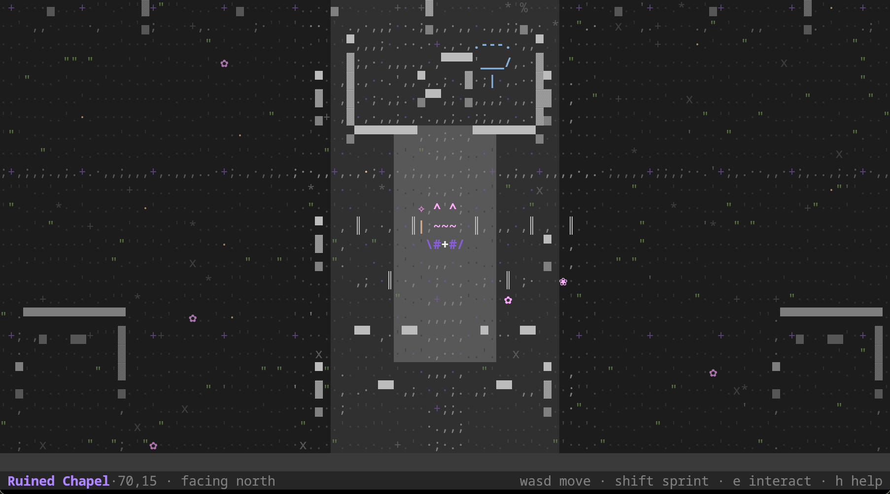
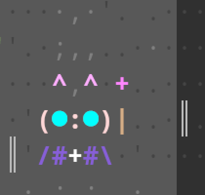
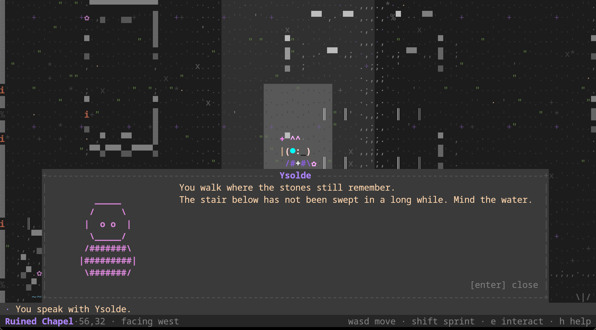
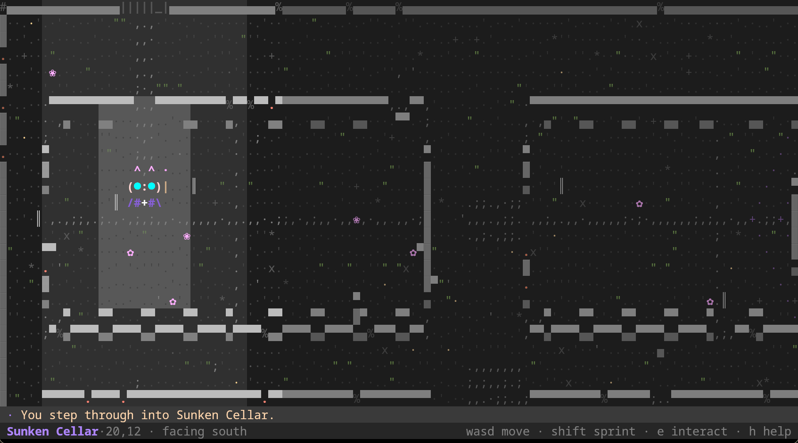
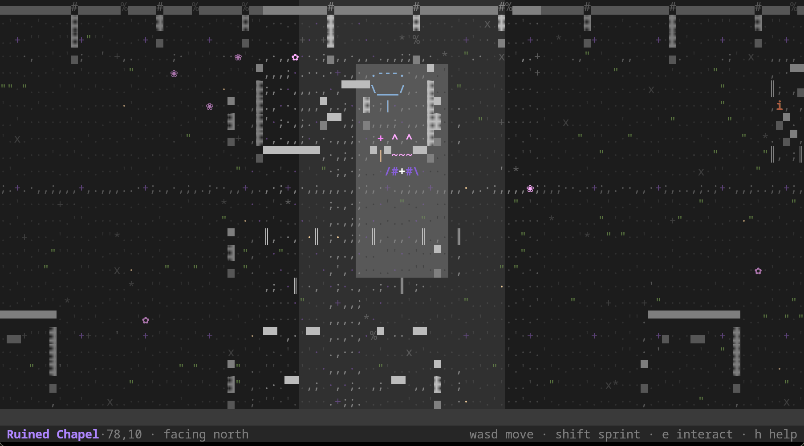
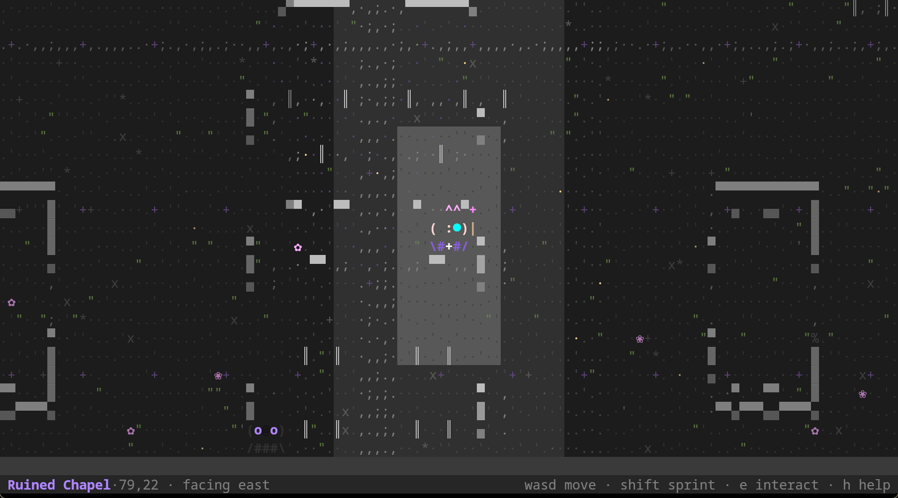

<div align="center">

# ⛧ Grimmoire

**A terminal-native, ASCII-first dark-fantasy wizard RPG.**

Every wall, every candle, every face is a character drawn into a cell grid by a
renderer Grimmoire owns. No image files, no sprites, no graphics protocol — just
glyphs, ink, and light.

[](https://github.com/etokiyra/grimmoire/actions/workflows/ci.yml)
[](LICENSE)
[](https://www.rust-lang.org/)
[](https://sw.kovidgoyal.net/kitty/)
[](#requirements)
[](#why-it-looks-the-way-it-does)



</div>

> **Status: early development.** There is no release and no tagged version yet.
> Grimmoire is a small, playable **exploration prototype** — two large connected
> areas, responsive movement with sprinting, interaction, one NPC, and fail-soft
> saving — on top of a custom ASCII renderer. It is not a complete game.

## What it is

A game about a wizard who grows stronger through **knowledge rather than gear**,
built for the terminal and taking **ASCII art as its primary visual language**
rather than as a limitation to escape.

The long-term vision is exploration, character-focused dialogue, strategic
turn-based magic combat, skill trees, and story-and-mastery progression. The
story, world, characters, and detailed mechanics are **deliberately undecided** —
everything currently in the game is placeholder content. See
[`ROADMAP.md`](ROADMAP.md).

## Why it looks the way it does

- **ASCII is the identity, not a fallback.** The world is a grid of glyphs drawn
  by a renderer Grimmoire owns (`ui::scenery`). Block and box glyphs (`█`, `▓`,
  `▀`, `·`) are legitimate drawing elements. There is no hidden image underneath.
- **Structure comes from neighbours.** A wall shows a lit cap where floor is
  above it, a shadowed base where floor is below, a side face, or a pillar when it
  stands alone. Terrain is not a repeating tile.
- **Variation comes from position, never from time.** Each tile's texture is a
  hash of its *world* coordinates, so the world never shimmers when the clock
  advances.
- **Light comes from distance.** Tiles near the player fall into a warm autumn
  wash; the far walls drop into the dark. The space reads as lit rather than flat.
- **Characters are figures with several inks at once.** A cast member carries its
  own ink set, and each row of its sprite names one — so hair, skin, cloth, trim
  and eyes are separate colours. Figures are **five cells wide and three tall**,
  the height of a doorway or a tree.
- **Maps are authored at the character's scale.** No passage the player can stand
  in is narrower than three cells, and the routes walked constantly are wider
  still. The generator refuses to emit a map that breaks the rule, and a test
  enforces it. See [`docs/map-design.md`](docs/map-design.md).

The player is a kawaii mage bunny: long pink ears, a pale face with two big bright
eyes, a violet robe with white lace, and a star wand that twinkles.

<div align="center">

</div>

## Screenshots

<div align="center">

**Speaking with Ysolde, who has no face** — the dialogue panel rises into place
rather than appearing, and the world keeps breathing behind it.



**The Sunken Cellar** — the arrival is marked, and the stair has not been swept in
a long while.



**The altar in the apse**, and a walk through the nave.




</div>

## Requirements

**Grimmoire runs in [Kitty](https://sw.kovidgoyal.net/kitty/).** It uses Kitty's
keyboard protocol so that it can see key *releases*, which is what makes "hold to
walk, release to stop" work properly. If it cannot establish that the terminal can
do this, it says so and exits rather than starting in a mode that would feel
broken.

Everything else it needs is a Rust toolchain (**1.85+**, edition 2024) and a
terminal of at least **80×24** reporting 256 colours.

## Play it

```sh
kitty --directory "$PWD" cargo run --release
```

You start in the **Ruined Chapel**. The stair down to the Sunken Cellar is at the
south end of the nave; **Ysolde** and a cracked basin are elsewhere in the chapel,
and a faded sigil waits at the far side of the cellar. Press <kbd>e</kbd> when the
prompt appears.

| Key | Action |
| --- | --- |
| <kbd>W</kbd> <kbd>A</kbd> <kbd>S</kbd> <kbd>D</kbd> or arrows | Move, and face that way. **Hold to keep walking.** |
| <kbd>Shift</kbd> + a direction | Sprint |
| <kbd>E</kbd> | Interact with what you face |
| <kbd>H</kbd>, <kbd>?</kbd>, <kbd>F1</kbd> | Help and diagnostics |
| <kbd>F3</kbd> | Presentation study (rendering prototype) |
| <kbd>F2</kbd> | Renderer showcase (development screen) |
| <kbd>Esc</kbd>, <kbd>Q</kbd>, <kbd>Ctrl</kbd>+<kbd>C</kbd> | Quit |

Progress saves automatically on quit and whenever you move between areas — see
[`docs/gameplay.md`](docs/gameplay.md) for the save location and format.

Below **80×24** the game suspends, shows a short explanation, and swallows input
so you cannot act blind, then resumes exactly where you were when the window
grows. Grimmoire cannot maximise your window; that part is yours.

## What works today

**The exploration prototype**

- Two large connected areas that are **bigger than the viewport**, so the camera
  scrolls and the environment fills the screen.
- Tile-based movement with collision against terrain, boundaries and entities,
  plus a facing direction so you can face what you want to use.
- **Event-driven movement**: a press steps at once, holding walks at a steady
  cadence, releasing stops immediately, and <kbd>Shift</kbd> sprints. A tap is
  always exactly one step, and no lost event can leave you walking on your own.
- **Visible feedback**: a refused step pulses the tile that refused it, an
  interaction flashes whatever answered and throws off sparkles, and arriving
  somewhere new marks the spot — all as a style change, so nothing can ever hide a
  glyph.
- **Animation that keeps pace**: characters stride once per *step* (never on a free
  running clock), sprint with a lean and a wake, breathe and blink when idle, and
  the dialogue panel rises and settles rather than appearing.
- **Both axes move at the same screen speed.** Terminal cells are taller than they
  are wide, so the two axes are paced from one speed in pixels per second rather
  than a single step rate — which is what stops vertical movement feeling twice as
  fast as horizontal.
- An interaction model resolved deterministically from the adjacent tiles, with a
  contextual prompt instead of permanent instructions.
- Automatic, versioned, **fail-soft** persistence of area, position and discovered
  areas: anything unrecognised means "start a new game", never a half-loaded one.

**The renderer underneath**

- A **custom ASCII scenery renderer** — neighbour-aware walls, position-hashed
  floors, rolling water, guttering candles, drifting motes, and an inlaid motif cut
  into each area's open floors.
- A pure, terminal-agnostic cell renderer: `Canvas`, `Cell`, `Style`, `Color`,
  `Rect`, and a clipped local-coordinate `CanvasView`.
- A **fully opaque, application-owned background**: the theme paints every cell and
  foreground-only draws inherit the surface, so the terminal's own theme can never
  show through.
- **Diffed presentation**: only changed cells are written. An unchanged frame costs
  sixteen bytes.
- **A 60 Hz loop while anything is moving** (measured at 60–64 frames a second),
  dropping to a slow ambient tick when the world is merely breathing, so an
  untouched game costs about **half a percent of a core**.
- Time-based animation with an explicitly advanced, testable clock.
- A screen stack with layered composition, a curtain transition, and a
  **minimum-viewport policy**.
- Optional **pixel interface art** behind a development flag, off by default; the
  game itself never emits a graphics sequence.

## Not implemented yet

Combat, spells, inventory, items you can pick up, quests, skill trees, and story.
There is one NPC and no dialogue branching or scripting. The two areas are
hand-authored placeholders.

## Build and run

```sh
cargo run                        # run a debug build
cargo run --release              # run an optimised build
cargo run --release -- --study   # the presentation study
cargo build --release            # produce target/release/grimmoire
```

Resize the terminal freely: the layout and camera are recomputed, and below 80×24
play suspends to a short explanation rather than drawing a mangled layout. The
terminal — including the Kitty keyboard protocol — is restored on a normal exit,
on a recoverable error, and from a panic.

### Development overrides

| Variable | Effect |
| --- | --- |
| `GRIMMOIRE_ASSUME_KITTY=1` | Assume the terminal is Kitty even if it cannot be confirmed. For inspecting the game in another terminal, and for the pty smoke test. |
| `GRIMMOIRE_PIXEL_UI=1` | Draw interface pieces (the dialogue portrait) as pixel art. Off by default; equivalent to `--pixel-ui`. |
| `GRIMMOIRE_FRAME_STATS=1` | Print the measured frame rate on exit. |

## Development

Run the same checks that CI runs:

```sh
cargo fmt --all --check
cargo clippy --all-targets --all-features -- -D warnings
cargo test --all-targets
cargo build --release
```

Three tools are kept honest by use:

```sh
tools/smoke.sh                     # pty smoke test: terminal lifecycle and cleanup
cargo run --release --example preview    # print the ASCII world to the terminal
cargo run --release --example bench      # the performance numbers in the design doc
```

`examples/preview` is the quickest way to look at scenery: it renders a real area
as text, so art changes can be read and diffed without a screenshot.

## Architecture

Grimmoire owns its drawing model, layout, frame composition, scenery and
animation. It borrows plumbing for low-level terminal operations and does **not**
build a terminal emulator.

| Module | Responsibility |
| --- | --- |
| `game` | The world model and its rules: areas, tiles, entities, movement, collision, interaction, travel. Pure — no rendering, no I/O. |
| `save` | A small versioned format and the only code that touches the save file. |
| `render` | Pure, terminal-agnostic drawing: cells, styles, colours, rectangles, canvases, views, `Frame` composition, image handles, and the optional PNG encoder. |
| `terminal` | The **only** module that talks to the terminal: raw mode, alternate screen, the Kitty keyboard and graphics protocols, input, capability detection, and diffed presentation. |
| `anim` | Time-based animation with an explicitly advanced clock. |
| `input` | Terminal-independent key and event types, including press/repeat/release. |
| `ui` | Frame composition: the ASCII scenery renderer, character animation, feedback effects, theme, layout, motion, screens, transitions, the screen stack, and the viewport policy. |
| `app` | Wires input, update, compose and present together. |
| `pixel` | Software pixel rendering, used only by optional interface art. |

The dependency list is deliberately short: **`crossterm`** for terminal lifecycle
and input, **`unicode-width`** for the text width policy, and **`fdeflate`** solely
to encode the optional pixel interface art. `ratatui` was rejected because it would
own the drawing model. No image decoder is needed — Kitty decodes.

### Documentation

- [`docs/renderer-design.md`](docs/renderer-design.md) — the rendering
  architecture, the ASCII scenery renderer, the movement model and why the two axes
  are paced differently, the measured numbers, and what was verified live.
- [`docs/gameplay.md`](docs/gameplay.md) — the world model, controls, movement,
  interaction rules, and save format.
- [`docs/map-design.md`](docs/map-design.md) — the rules an area must satisfy, and
  how they are enforced.
- [`AGENTS.md`](AGENTS.md) — the vision, the boundaries, and the invariants.
- [`ROADMAP.md`](ROADMAP.md) — phasing for future work.

## Key decisions

- **ASCII is the identity, not a fallback.** The world is a glyph grid drawn by a
  renderer Grimmoire owns. Pixel rendering exists only as an off-by-default
  interface extra, and the default path sends no graphics at all.
- **Kitty is the supported terminal**, for its keyboard protocol and colour depth.
- **Movement is event-driven, never timer-driven.** A press steps at once, holding
  walks at a cadence, releasing stops.
- **The two axes share a screen speed, not a cadence.** Cells are not square, and
  pretending otherwise is what made vertical movement feel fast.
- **Animation is time-based, and the walk cycle is locked to steps.** A slow machine
  must not slow the world down, and the legs must not drift away from the movement
  they are illustrating.
- **A frame is composed when something changed, and only changed cells are written.**
- **The world is larger than the viewport**, and the camera scrolls; the HUD is an
  overlay of two rows rather than rows taken from the world.
- **A hard minimum viewport (80×24).** Grimmoire suspends safely below it rather
  than degrading into noise.
- **No ECS, no scripting engine, no widget toolkit** until a phase needs one.
- **Game logic is pure.** Movement, collision, interaction and travel are testable
  without a terminal; the UI decides how things look.
- **Artwork is source text, not files.** The world is glyph tables and neighbour
  rules; the optional interface art is ASCII sprite tables rendered in memory.
  Nothing is read from disk, so there is no third-party imagery and no missing file
  to break the game.

## Known limitations

- **Kitty only.** Other Kitty-protocol terminals are untested, and tmux/zellij may
  intercept the keyboard protocol.
- **One glyph per cell.** Wide and zero-width glyphs are not rendered; the cell
  model has no continuation cell.
- Presentation repaints per changed cell rather than tracking damage rectangles. A
  step with a scrolled camera rewrites a few thousand cells.
- The world is two rooms with one NPC and no dialogue branching; the art is
  placeholder.
- Visual verification was done on Linux under Kitty 0.49.2; other platforms are
  untested.
- Terminal restoration cannot be guaranteed against `SIGKILL` or power loss.

## License

Grimmoire is free software, released under the **GNU General Public License,
version 3 or later** ([GPL-3.0-or-later](LICENSE)). You may use, study, share and
modify it under those terms.

All artwork is generated from source text in this repository and carries no
third-party rights.
